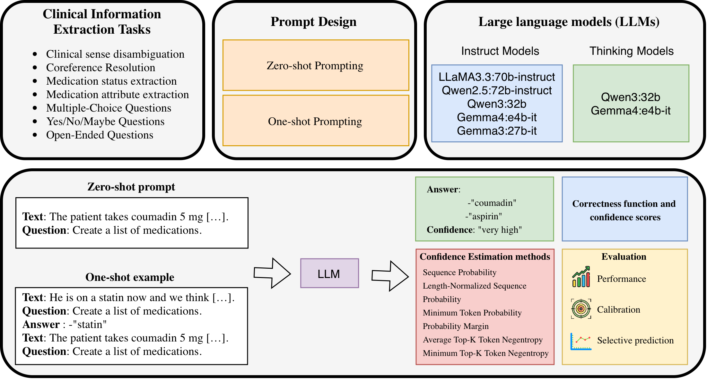

# A Study of Confidence Estimation in Large Language Models for Clinical Information Extraction: An Assessment of Performance, Calibration, and Selective prediction

This is the repository for `A Study of Confidence Estimation in Large Language Models for Clinical Information Extraction: An Assessment of Performance, Calibration, and Selective prediction`. This paper presents a comprehensive study of confidence estimation in LLMs, evaluating five open-weight models in both reasoning and non-reasoning modes on zero-shot and one-shot medical information extraction tasks.

For further information regarding CDE.AI project, please visit the following link :
- https://www.limics.fr/lorem-ipsum-6/

**Note:** Due to the confidentiality of medical data, the CDE.AI dataset and its processing code are not provided in this repository.

---
## Overview of our study on confidence estimation and evaluation.



---
## Repo content
The structure of the repo is as the following :
- [img](img) : Contains the images illustrating the results.
- [src](src) : Contains the code of our study on confidence estimation and evaluation.
    - [config](src/config.py): Contains the LLM configuration file.
    - [utils](src/utils.py): Contains utility functions.
    - [clinical_sense_disambiguation](src/clinical_sense_disambiguation.py): Contains the code used for the clinical sense disambiguation task. It includes the complete pipeline, from information extraction to performance evaluation.
    - [coreference_resolution](src/coreference_resolution.py): Contains the code used for the coreference resolution task, including the complete pipeline from information extraction to performance evaluation.
    - [medication_attribute_extraction](src/medication_attribute_extraction.py): Contains the code used for the medication attribute extraction task, including the complete pipeline from information extraction to performance evaluation.
    - [medication_status_extraction](src/medication_status_extraction.py): Contains the code used for the medication status extraction task, including the complete pipeline from information extraction to performance evaluation.

---
## Quick Start with Clinical Information Extraction, Confidence Estimation and Evaluation

You can follow the steps below to quickly get up and running with experimentation.

1. **Clone and Download the Repository**

   ```bash
   git clone https://github.com/ibtraore/mie-confidence-estimation.git
   cd mie-confidence-estimation
   ```

2. **Create and Activate a New Virtual Environment**

    For Mac/Linux/WSL
    ```bash
    python3 -m venv confidence-evaluation-venv
    source confidence-evaluation-venv/bin/activate
    ```

3. **Install Dependencies**

   In the top-level directory, run:
   ```bash
   pip install -r requirements.txt
   ```

4. **Set Up the API URL (and API Key for Online Models)**

   In the [`config`](src/config.py) file, you need to specify the `base_url` (and the `api_key` if you are using online models).

5. **Prepare the Data Folder**

   Create a `data` folder and place the required CSV files inside it.
   To access the datasets, please visit the following link: https://huggingface.co/datasets/mitclinicalml/clinical-ie

6. **Run the Script**

   Use the following command:

   - For Clinical Sense Sisambiguation Task

    ```bash
    python src/clinical_sense_disambiguation.py 
    ```

    - For Coreference Resolution Task

    ```bash
    python src/coreference_resolution.py 
    ```

    - For Medication Attribute Extraction Task

    ```bash
    python src/medication_attribute_extraction.py 
    ```

    - For Medication Status Extraction task Task

    ```bash
    python src/medication_status_extraction.py 
    ```

---
## Which confidence estimation method should be used for better discrimination, calibration, and selective prediction?
Confidence estimation can be effectively employed in various applications, including hallucination detection and mitigation, uncertainty-guided data utilization, ambiguity detection, and selective generation. We provide the following recommendations according to the evaluation objectives:

- **Best Discrimination (AUROC)**: `ATN@K, MTN@K, SP, or LNSP` - Use one of these methods for maximum discrimination between correct and incorrect answers.
- **Best prioritization (AUPRC)**: `ATN@K, MTN@K, SP, or LNSP` -  Use one of these methods when prioritizing the identification of correct answers.
- **Best selective prediction (AUARC)s**: `ATN@K, MTN@K, SP, or LNSP` - Use one of these methods for a trade-off between prediction accuracy and coverage as low-confidence answers are progressively rejected.
- **Best Calibration (ECE)**: `MTN@K` - Use this when you need well-calibrated confidence scores.

